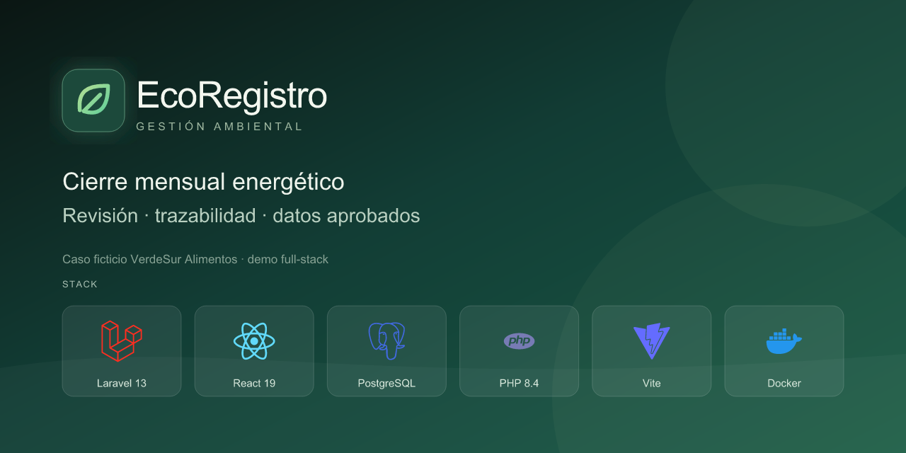

# EcoRegistro



## Demo en vivo

**[Abrir EcoRegistro →](https://ecoregistro-52v8.onrender.com/)**

Si la demo estuvo inactiva un rato, Render puede mostrar *Application loading* unos **30–90 segundos** antes del login.

| Rol | Correo | Contraseña |
| --- | --- | --- |
| Operador | operador@ecoregistro.test | EcoRegistroDemo2026! |
| Revisor | revisor@ecoregistro.test | EcoRegistroDemo2026! |

Recorrido sugerido en **3–5 min** más abajo en este README.

**EcoRegistro** es un sistema de demostración para el **cierre mensual de consumo energético** en instalaciones industriales: carga operativa, revisión independiente, historial auditable y reportes construidos **únicamente con datos aprobados**.

Caso ficticio **VerdeSur Alimentos** (dos plantas). Datos, facturas y factores de emisión son sintéticos; no constituye certificación ni datos reales de una organización.

## La problemática

Las áreas ambientales suelen cerrar el mes con información **incompleta**, **duplicada** o **imposible de auditar**:

- Un consumo se carga dos veces o se mezcla borrador con dato validado.
- Nadie recuerda quién aprobó un total ni con qué factor se calculó.
- Un mes sin registro se interpreta por error como “cero consumo”.
- Consumo total e intensidad (kWh/t) se leen como si midieran lo mismo.

EcoRegistro aborda ese cierre con un flujo explícito (`borrador → enviado → aprobado` / corrección), historial por registro, cobertura por instalación y export CSV trazable.

Más contexto de negocio: [docs/NEGOCIO.md](docs/NEGOCIO.md).

## Stack técnico

| Capa | Tecnología |
| --- | --- |
| Backend | PHP **8.4**, **Laravel 13**, API JSON, sesiones, PHPUnit |
| Frontend | **React 19**, Vite 8, CSS con tema claro/oscuro (sistema) |
| Datos | **PostgreSQL 17** (Docker) o SQLite (desarrollo rápido) |
| Contenedor | Docker Compose (app + base de datos) |
| Calidad | Feature tests PHP, recorrido E2E con Playwright |

## Por qué revisarlo

- Flujo de negocio claro entre **operador** y **revisor**, con reglas en backend.
- El dashboard expone **cobertura del cierre** y distingue “sin registro” de consumo cero.
- Trazabilidad: quién cambió qué, y qué **factor de emisión** quedó al aprobar.
- Código orientado a API + SPA sin frameworks de UI pesados; tema claro/oscuro según el sistema.

## Qué incluye la demo

- Roles **operador** y **revisor** con permisos distintos en servidor.
- Un registro por instalación y mes (unicidad validada).
- Dashboard por período: consumo, emisiones estimadas, intensidad ponderada y **cobertura del cierre**.
- Bandeja de revisión, historial de cambios y factor congelado al aprobar.
- Exportación CSV solo de registros aprobados.
- UI responsive; fuentes empaquetadas (sin CDN de tipografías).

## Inicio rápido (Docker)

Requisitos: Docker Desktop con Compose.

```sh
docker compose up --build
```

Abre **http://localhost:8000**. El primer arranque migra y siembra datos de demo.

| Rol | Correo | Contraseña demo |
| --- | --- | --- |
| Operador | operador@ecoregistro.test | EcoRegistroDemo2026! |
| Revisor | revisor@ecoregistro.test | EcoRegistroDemo2026! |

En macOS también puedes usar `Iniciar_EcoRegistro.command` en la raíz del proyecto.

## Ejecución local (SQLite)

```sh
composer install
npm ci
cp .env.sqlite.example .env
touch database/database.sqlite
php artisan key:generate
php artisan migrate --seed
npm run build
php artisan serve
```

## Recorrido sugerido (3–5 min)

1. **Operador** — Resumen en mayo (cierre completo) vs junio (cobertura parcial).
2. **Operador** — Crear un registro nuevo, enviarlo a revisión.
3. **Revisor** — Aprobar o solicitar corrección con motivo; revisar historial.
4. **Cualquier rol** — Exportar CSV y contrastar con lo que muestra el dashboard.

## Pruebas

```sh
php artisan test
npm run build
npx playwright install chromium
npm run test:e2e
```

## Documentación

- [Negocio e historias de usuario](docs/NEGOCIO.md)
- [Fórmulas y factores](docs/METODOLOGIA.md)
- [Arquitectura y API](docs/ARQUITECTURA.md)
- [Modelo de datos](docs/DATOS.md)

## Despliegue en Render

La demo pública usa el blueprint [`render.yaml`](render.yaml) (Docker, SQLite embebida en imagen). Cada `git push` a `main` puede redesplegar el servicio si está enlazado al repo.

## Licencia

Código del proyecto: **MIT**. Dependencias de Laravel y terceros: sus licencias respectivas.